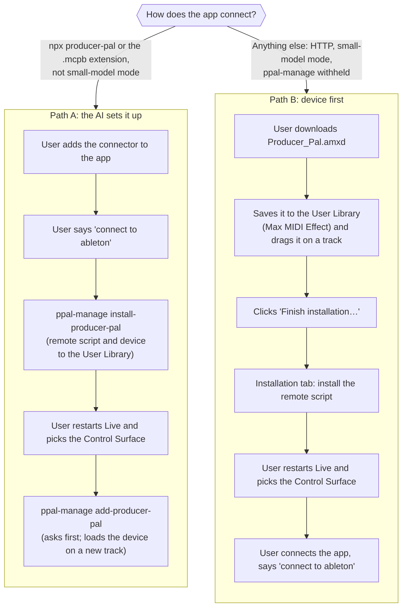

# Install Paths

A new user gets set up one of two ways. Which one depends on how the AI app
connects.

Both paths end with the same step: restart Live, then choose Producer Pal as a
Control Surface in Settings → Tempo & MIDI, Input and Output left as None.
Neither half works alone on a first install: Live only finds the script on
restart, and a restart doesn't pick the slot. In Path A the user can also drag
the installed device onto a MIDI track themselves instead of calling
`add-producer-pal`; `add-producer-pal` before the script runs only installs the
device file and says so.

## Which code answers each step

| Step                                          | Code                                                                                                                                                                                                                                                                                                                 |
| --------------------------------------------- | -------------------------------------------------------------------------------------------------------------------------------------------------------------------------------------------------------------------------------------------------------------------------------------------------------------------- |
| `install-producer-pal` before any device runs | The portal answers it from local files: `src/portal/offline/offline-install-producer-pal.ts`, using `src/portal/setup/` and the shared steps in `src/mcp-server/rpc/remote-script/install/producer-pal-install-reply.ts`                                                                                             |
| `install-producer-pal` with the device up     | The portal answers it when the running device is older than the portal (`src/portal/update/answer-install-when-device-older.ts`); otherwise the device does: `src/tools/core/manage.ts`, then `src/tools/core/helpers/manage-install.ts`, then the Node route that installs the script and copies the running device |
| `add-producer-pal`                            | `src/portal/offline/offline-add-producer-pal.ts` (the device isn't running yet; `manage.ts` refuses it once it is)                                                                                                                                                                                                   |
| `update-producer-pal` (later upgrades)        | `src/portal/update/update-producer-pal.ts`; only the portal can run it                                                                                                                                                                                                                                               |
| **Finish installation…** button               | The Max device opens the Chat UI's Settings → Installation (`webui/src/components/settings/installation/`)                                                                                                                                                                                                           |
| Installation tab buttons                      | `src/mcp-server/routes/remote-script-setup-route.ts`, `src/mcp-server/rpc/remote-script/install/`, `src/mcp-server/rpc/device-install/`                                                                                                                                                                              |
| The script itself                             | `remote-script/Producer_Pal/`, loaded by Live as a Control Surface                                                                                                                                                                                                                                                   |

## Upgrades

From 2.5 on, Path A users update the connector, then ask the AI to update
Producer Pal and its remote script, then restart Live. The portal installs its
own script and device when the running device is older, so either can go first;
if the update needs a newer script than the device's, the AI installs it, asks
for a restart, then updates the device. `update-producer-pal` swaps the new
device into the open Set. A 2.4 device has no `ppal-manage`, and the 2.4 remote
script was an optional prototype, so 2.4 → 2.5 is by hand: replace the `.amxd`
in the User Library, then take Path B from **Finish installation…**. User steps
are in `docs/installation/upgrading.md`.
