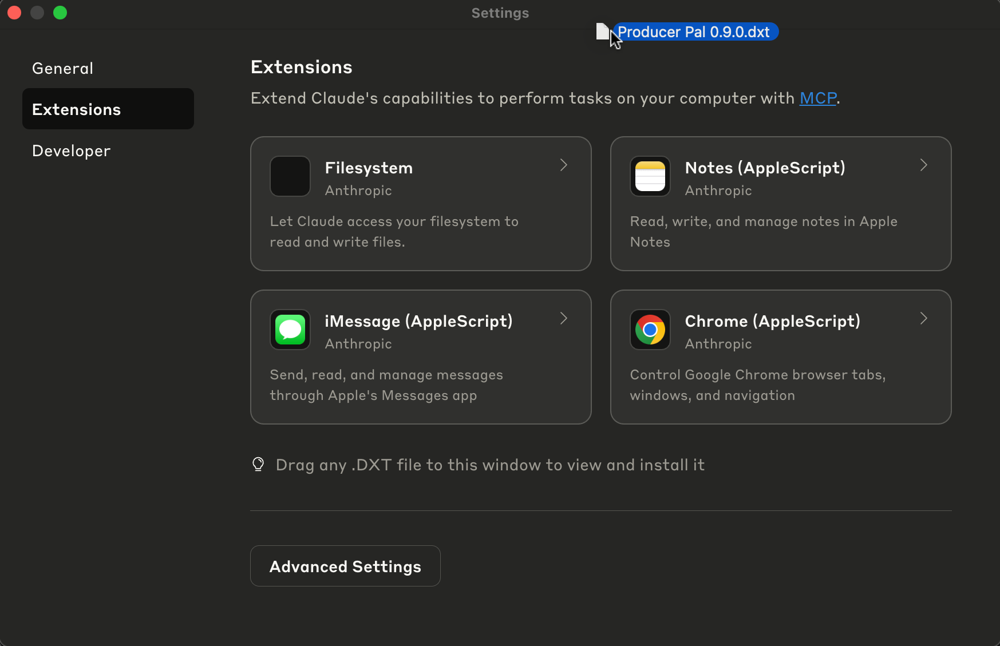
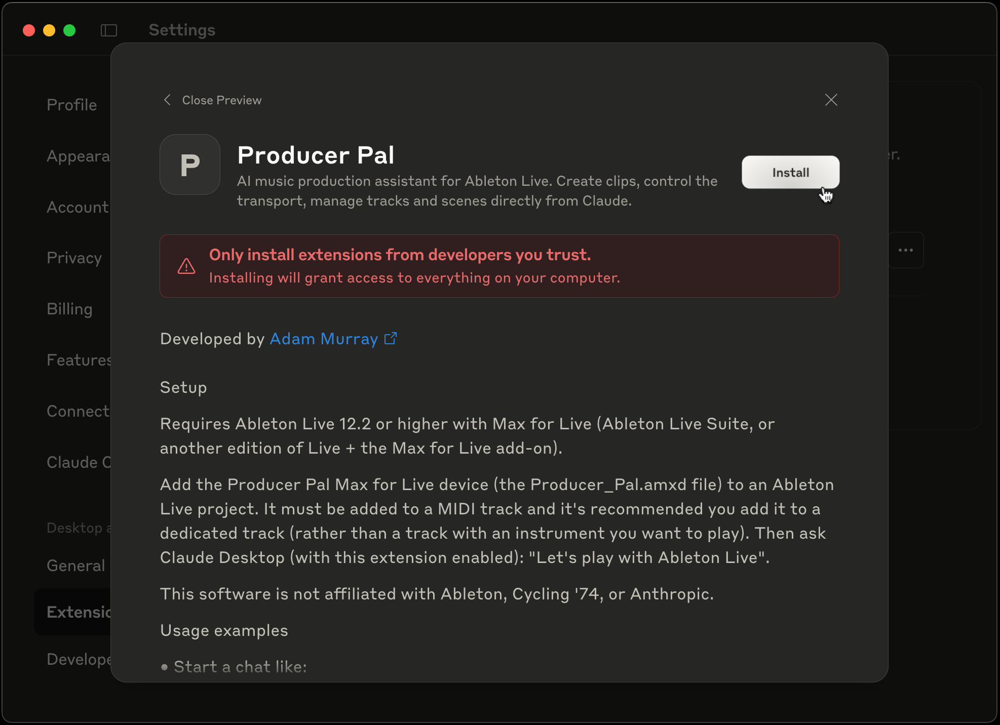
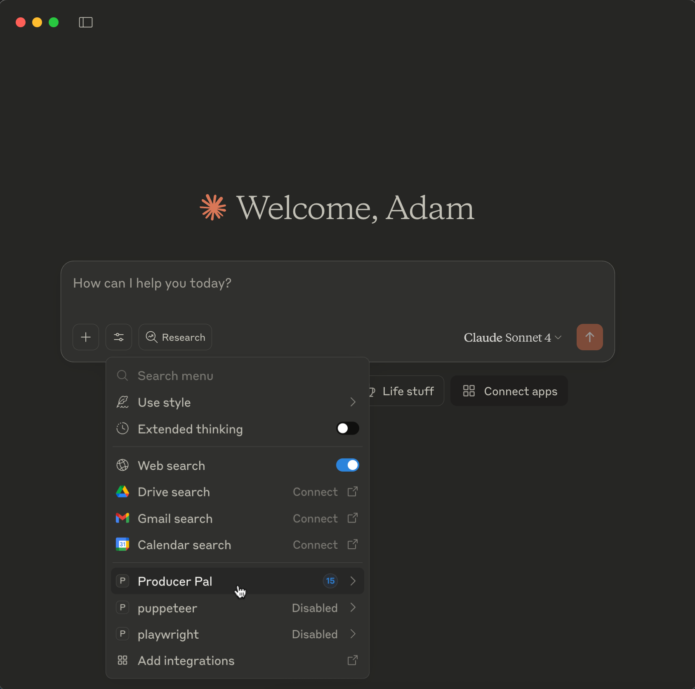
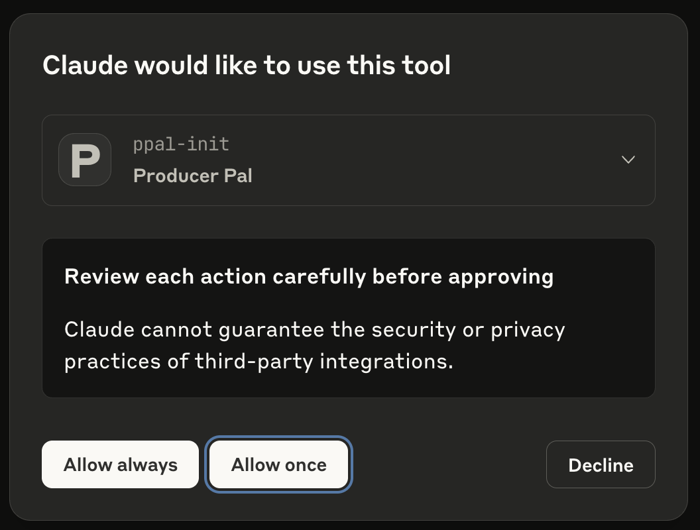
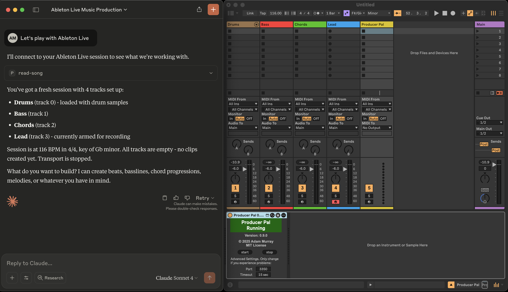

# Claude Desktop Installation

Anthropic's Claude Desktop app is an easy way to use Producer Pal with a Claude
account.

## Requirements

  
Get the extension, then follow the steps below. Claude can install the device for you.

  

    <a class="download-btn download-btn-primary" href="https://github.com/adamjmurray/producer-pal/releases/latest/download/Producer_Pal.mcpb">
      Claude Desktop Extension
      Producer_Pal.mcpb — for Claude Desktop
    </a>
    <a class="download-btn" href="https://github.com/adamjmurray/producer-pal/releases/latest/download/Producer_Pal.amxd">
      Max for Live Device (optional)
      Producer_Pal.amxd — to install it yourself
    </a>
  

<!--@include: ../_partials/live-version.md-->

- [Claude Desktop](https://claude.ai/download) (requires Anthropic account)

## Installation Steps

<!--@include: ../_partials/setup-by-ai.md-->

### 1. Download the Claude Desktop Extension

Download the
[Producer Pal Claude Desktop Extension (`Producer_Pal.mcpb`)](https://github.com/adamjmurray/producer-pal/releases/latest/download/Producer_Pal.mcpb)

### 2. Install the Extension in Claude Desktop

Go to Claude Desktop → Settings → Desktop app, scroll down to **Extensions**,
and click "Manage":

Then drag and drop `Producer_Pal.mcpb` into the Extensions screen:

### 3. Complete the Installation

Don't forget to click "Install" and complete the Claude Desktop installation:

**About the security warning:** Anthropic displays this warning for all
extensions as a general security measure. Producer Pal is open source and you
can review the entire codebase on
[GitHub](https://github.com/adamjmurray/producer-pal) before installing.

Other ways of connecting skip this warning but aren't any safer, since Producer
Pal runs the same software in Live either way. This extension also adds
conveniences: it can respond when Live isn't running, install the
[remote script](/guide/remote-script) and Max for Live device for you, and add
the device to a Live Set that doesn't have one.

### 4. Verify Installation

Producer Pal now appears on the Extensions screen:

In a chat, you should see Producer Pal in the "+" menu under "Plugins" (make
sure it's enabled when starting a conversation):

### 5. Start Using Producer Pal

With Live open, start a conversation with "connect to ableton". Allow Producer
Pal tools when Claude tries to use them:

::: tip Skip the permission prompts

Instead of approving tools one at a time, either:

- Go to Settings → Desktop app → Extensions, click "Configure" next to Producer
  Pal, and set **Tool permissions** to "Always allow":

  

- Or switch the chat to **Auto** mode. Claude stops asking for most tools (such
  as the read-only ones), but may still ask for some.

:::

<!--@include: ../_partials/setup-by-ai-finish.md-->

<!--@include: ../_partials/check-it-works.md-->

## Advanced settings

The extension exposes a few optional settings at the top of its "Configure"
screen (**Claude Desktop → Settings → Desktop app → Extensions → Producer Pal →
Configure**). Most people never need to touch these — the defaults are
recommended.

- **Ableton device URL** — where to reach the Max for Live device (default
  `http://localhost:3350`). Change only if you moved the device's port or are
  connecting over the network.
- **MIDI notation** — how Producer Pal reads and writes clip notes. Three valid
  values: `barbeat` (recommended for Claude Sonnet, Opus, and Fable), `stark`
  (pairs well with **Small model mode**), or `midi-json` (pairs well with **JSON
  output**). Leave blank, or enter anything else, to follow the device's current
  setting (`barbeat` by default).
- **Small model mode** — simplifies the tools and instructions for smaller
  models. May improve results with **Claude Haiku**; not recommended otherwise,
  since Claude Sonnet, Opus, and Fable handle the full toolset. Turn it on only
  after the device is in your Live Set: it hides the tool that sets Producer Pal
  up.
- **Direct Live API** — enables the advanced
  [`ppal-live-api`](/features/tools#ppal-live-api) tool for direct access to the
  [Live Object Model](https://docs.cycling74.com/apiref/lom/). An escape hatch
  for custom control and debugging when the standard tools aren't enough — not
  recommended as a default.
- **JSON output** — returns tool results as JSON instead of the compact default.
  Not recommended for normal use (it increases token usage), but useful when you
  want Claude to run code on the results.
- **Tools** / **Disable tools** — narrow the [toolset](/features#toolset) Claude
  Desktop sees. Comma-separated tool names (`read-clip` or `ppal-read-clip`)
  and/or groups: `core`, `session`, `actions`, `live-set`, `track`, `scene`,
  `clip`, `device`, `advanced`, `read-only`. Withholding a tool also drops the
  [skills](/features#skills) that teach it, so every conversation gets smaller.
  `ppal-connect` is always kept.

::: info These settings are the extension's own

They apply to Claude Desktop and nothing else — the [chat UI](/guide/chat-ui)
and any other connected MCP client keep their own settings.

That cuts both ways for the three checkboxes: **Small model mode**, **Direct
Live API**, and **JSON output** are off here unless you turn them on here.
Switching them on in the device's Setup tab won't change what Claude Desktop
sees. **MIDI notation**, **Tools**, and **Disable tools** are different — leave
one blank and the extension follows the device.

:::

## Troubleshooting

If it doesn't work, see the [Troubleshooting Guide](/support/troubleshooting).
